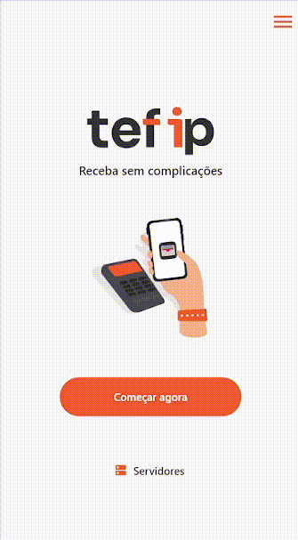
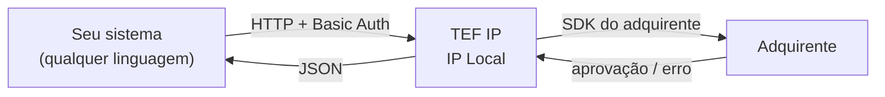

# TEF IP

Aceite pagamentos com qualquer adquirente usando uma única API HTTP local. Instale no terminal e comece a processar.

## O que você pode fazer

| Para | Use | Detalhes |
|------|-----|----------|
| Cobrar no crédito, débito, PIX, dinheiro ou vale, à vista ou parcelado | `POST /transaction` | [Transações](api/transaction.md) |
| Consultar um pagamento pelo `referenceId` | `GET /transaction/{referenceId}` | [Transações](api/transaction.md) |
| Estornar um pagamento | `POST /transaction/{referenceId}/reversal` | [Transações](api/transaction.md) |
| Mostrar ao cliente a venda sendo montada, com itens, descontos e pagamentos | `/sale` | [Vendas](api/sale.md) |
| Pedir CPF/CNPJ, e-mail, CEP, texto livre ou uma escolha ao operador | `POST /ask` | [Coleta de Dados](api/ask.md) |
| Exibir texto, imagem ou carrossel na tela do terminal | `/display` | [Visor do Terminal](api/display.md) |
| Imprimir comprovantes, imagens, layouts ACBr ou o DANFE da NFC-e | `/print` | [Impressão](api/print.md) |
| Acompanhar logs em tempo real e avisar o operador | `/logs`, `/notification` | [Logs](api/logs.md) |
| Verificar se o terminal está online e reiniciar o app | `/status`, `/restart` | [Status e Manutenção](api/status.md) |

Veja abaixo um pagamento sendo processado no emulador:

{ style="display: block; margin: 0 auto;" }


---
## Como funciona



Seu sistema faz chamadas HTTP para o TEF IP. O TEF IP se comunica com o hardware do adquirente e retorna o resultado em JSON, sem nenhuma SDK proprietária no seu lado.

!!! tip "Sem maquininha? Use o emulador!"
    O TEF IP inclui um **modo emulador** que simula o hardware do adquirente localmente.
    Você pode desenvolver e testar toda a integração sem nenhum terminal físico.
    [Clique aqui para saber como usar o emulador](emulator.md)


---

## Integração rápida

Qualquer cliente HTTP funciona. Veja um exemplo completo, um PIX de R$ 50,00, nas linguagens mais comuns:

=== "cURL"

    ```bash
    curl -u admin:1234 \
         -H "Content-Type: application/json" \
         -X POST http://localhost:9050/transaction \
         -d '{"tPag":"17","amount":50.00,"referenceId":"pedido-001"}'
    ```

=== "Dart"

    ```dart
    import 'package:dart_tefip/dart_tefip.dart';

    TefIP.baseUrl = 'http://localhost:9050';
    TefIP.username = 'admin';
    TefIP.password = '1234';

    final result = await TefIP.instance.transaction.post(
      transactionRequest: TransactionRequestModel(
        type: TefIPTransactionType.pix,
        amount: 50.00,
        referenceId: 'pedido-001',
      ),
    );
    ```

=== "JavaScript"

    ```js
    // TODO: pacote JavaScript ainda não criado — usando fetch diretamente
    const res = await fetch('http://localhost:9050/transaction', {
      method: 'POST',
      headers: {
        'Authorization': 'Basic ' + btoa('admin:1234'),
        'Content-Type': 'application/json',
      },
      body: JSON.stringify({ tPag: '17', amount: 50.00, referenceId: 'pedido-001' }),
    });
    const data = await res.json();
    ```

=== "PHP"

    ```php
    <?php
    // TODO: pacote PHP ainda não criado — usando curl diretamente
    $ch = curl_init('http://localhost:9050/transaction');
    curl_setopt($ch, CURLOPT_USERPWD, 'admin:1234');
    curl_setopt($ch, CURLOPT_HTTPHEADER, ['Content-Type: application/json']);
    curl_setopt($ch, CURLOPT_POST, true);
    curl_setopt($ch, CURLOPT_POSTFIELDS, json_encode([
        'tPag' => '17',
        'amount' => 50.00,
        'referenceId' => 'pedido-001',
    ]));
    curl_setopt($ch, CURLOPT_RETURNTRANSFER, true);
    $response = json_decode(curl_exec($ch), true);
    curl_close($ch);
    ```

=== "Ruby"

    ```ruby
    # TODO: pacote Ruby ainda não criado — usando Net::HTTP diretamente
    require 'net/http'
    require 'json'

    uri = URI('http://localhost:9050/transaction')
    req = Net::HTTP::Post.new(uri, 'Content-Type' => 'application/json')
    req.basic_auth('admin', '1234')
    req.body = { 'tPag' => '17', amount: 50.00, referenceId: 'pedido-001' }.to_json
    res = Net::HTTP.start(uri.hostname, uri.port) { |h| h.request(req) }
    data = JSON.parse(res.body)
    ```

---

## Adquirentes suportados

Cada build do TEF IP é compilado para um adquirente e um modelo de terminal. A API é a mesma em todos: seu PDV não muda ao trocar de adquirente ou de maquininha.

| Adquirente | Terminais |
|------------|-----------|
| Stone | SmartPOS Stone, L400 |
| Rede | SmartPOS Rede, L400, N960K |
| Cielo | SmartPOS Cielo |
| Getnet | SmartPOS Getnet |
| PagSeguro | SmartPOS PagSeguro |
| Sicoob | Tectoy (Sunmi), DX8000, X990 |
| Vero | SmartPOS Vero |
| SiTef (multiadquirente) | Gertec GPOS700, Gertec GPOS720, L400 |

Não encontrou seu terminal? Fale com o suporte: novos modelos entram como um novo build, sem mudança na API.

---

## SDKs disponíveis

| Linguagem | Pacote | Status |
|-----------|--------|--------|
| Dart / Flutter | [`dart_tefip`](https://pub.dev/packages/dart_tefip) | Disponível |
| JavaScript | — | Sem pacote oficial no momento |
| PHP | — | Sem pacote oficial no momento |
| Ruby | — | Sem pacote oficial no momento |

Qualquer cliente HTTP funciona diretamente; os SDKs são conveniência, não requisito.

---

## Próximos passos

Novo por aqui? O guia de [Primeiros Passos](getting-started.md) mostra como instalar o TEF IP, verificar a conexão e fazer a primeira requisição em menos de 10 minutos.
